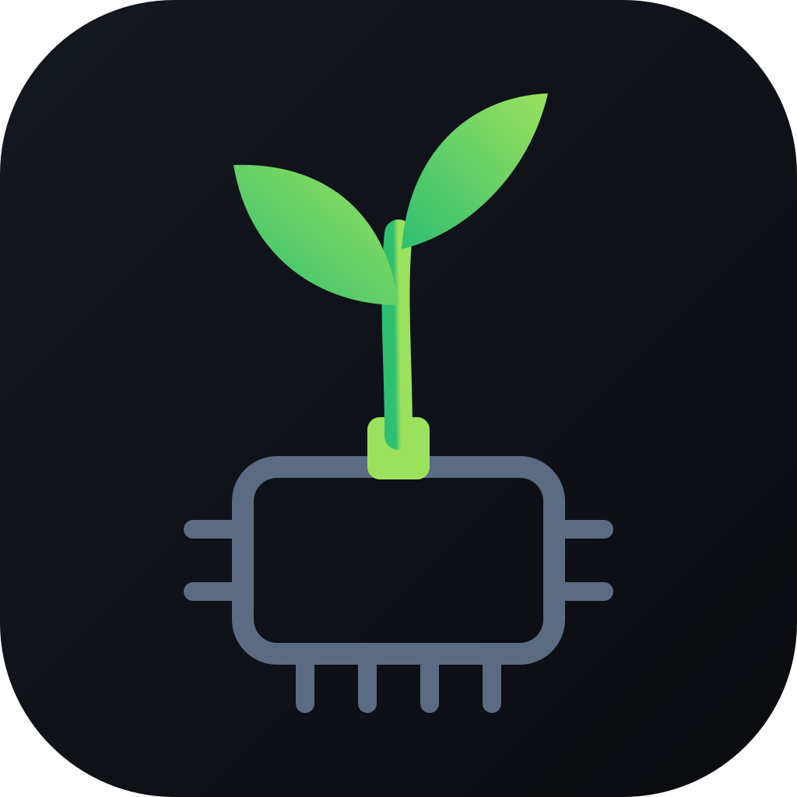

<!-- SPDX-License-Identifier: MIT-0 -->

<h1 align="center">Scion Project</h1>

<b>iOS 16.5 on Android phones</b>, on Apple's open-source XNU kernel and our own drivers. An experiment you build yourself from your own copy of iOS. These repositories contain no Apple software.

<a href="https://scion-project.github.io"><b>scion-project.github.io</b></a>

## Phones

| Phone | State | What to expect |
|---|---|---|
| **Galaxy S9** (SM-G960F, Exynos) | **Works** | iOS runs directly on the phone, with no emulator: all eight cores, touch, GPU, Wi-Fi, speakers, microphone, front camera, Bluetooth, sensors, battery. Tested on only a few phones so far |
| **Galaxy S9+** (SM-G965F) and **Note9** (SM-N960F) | **Unproven** | Nobody has run them. The installer does a 2-minute first run that collects a log, then returns to TWRP |
| **Pixel 10** | **Virtual machine, in progress** | iOS in a VM through the [Scion app](https://github.com/Scion-Project/scion). It reaches the home screen; touch was still being fixed at its last status. No ready-made install for other owners yet |

## Install on a Galaxy S9

You need an unlocked bootloader, TWRP, a computer and your own iOS 16.5 IPSW.

1. **Back up** Boot, System and EFS in TWRP, and copy the backup to a computer.
2. **Build the installer** on your computer with [scion-installer](https://github.com/Scion-Project/scion-installer).
3. **Flash the zip** in TWRP and reboot to System.

## Known issues

- One tester has reported the phone restarting by itself. The cause isn't known yet.
- No mobile network: no cellular data, calls or SMS.
- No rear cameras, and no headphones.
- No App Store, Apple ID, iCloud or iMessage.
- Settings are lost at each restart unless USERDATA is formatted for Scion, which erases Android's data.
- The passcode protects keychain items only. Your files aren't encrypted.

Something went wrong, or it worked? [Report a bug or send a tester report](https://github.com/Scion-Project/scion-kernel/issues/new/choose), with your model and `last_kmsg`. [How to save the logs](https://github.com/Scion-Project/scion-kernel#send-logs).

## Repositories

| Repository | What it is |
|---|---|
| [scion-installer](https://github.com/Scion-Project/scion-installer) | **Start here:** builds the TWRP installer on your computer (tooling only) |
| [scion-kernel](https://github.com/Scion-Project/scion-kernel) | The kernel, drivers, boot loader and tools; a fork of [HakiOS](https://github.com/oosexgang/hakios-xnu-kernel) |
| [scion-starlte](https://github.com/Scion-Project/scion-starlte) | Galaxy S9 device files and porting record |
| [scion-star2lte](https://github.com/Scion-Project/scion-star2lte) · [scion-crownlte](https://github.com/Scion-Project/scion-crownlte) | Galaxy S9+ and Note9 device files (never run) |
| [scion](https://github.com/Scion-Project/scion) · [scion-avf](https://github.com/Scion-Project/scion-avf) · [pyre](https://github.com/Scion-Project/pyre) | Pixel 10: the app, its VM backend and its emulator |
| [scion-recovery](https://github.com/Scion-Project/scion-recovery) | TWRP with extras for developers: APFS and HFS+ tools, log capture |

---

A *scion* is a cutting grafted onto another plant's rootstock.

Built on the work of the [HakiOS](https://github.com/oosexgang) and [ChefKiss](https://github.com/ChefKissInc) projects, Project Silicium, and the Exynos 9810 mainline community. Not affiliated with Apple, Samsung or Google.
