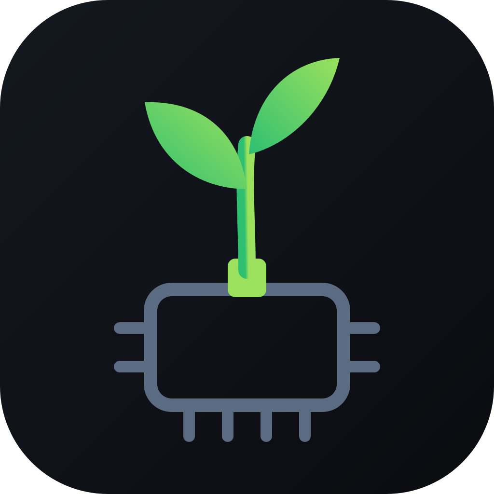

<!-- SPDX-License-Identifier: MIT-0 -->

<h1 align="center">Scion Project</h1>

<b>Apple's open-source XNU kernel on Android phones</b>, with our own drivers: <b>iOS 16.5 and iOS 27</b> on the Galaxy S9, from one kernel tree. An experiment you build yourself from your own copy of iOS. These repositories contain no Apple software.

<a href="https://scion-project.github.io"><b>scion-project.github.io</b></a>

The aim is one kernel tree for every phone Scion runs on, on the phones themselves, with Android kept beside it. Today
the tree builds on two of Apple's XNU releases (xnu-8796 for iOS 16.5, xnu-12377 for iOS 27) with shared drivers, and the
Galaxy S9 and the Pixel 10 are two machine configurations of the same iOS 27 tree. Choosing iOS or Android at power-on is
designed for the S9 and has not been run.

## Phones

Each line is one of three states: **seen on a phone**, **built, not yet run**, or **not built**.

| Phone | iOS 16.5 | iOS 27 |
|---|---|---|
| **Galaxy S9** (SM-G960F, Exynos) | **Seen on a phone.** All eight cores, touch, the GPU, Wi-Fi, speakers, microphone, front camera, Bluetooth, sensors, battery. Tested on only a few phones. The modem is built in since 17 November and **not yet run** under 16.5 | **Seen on a phone.** The home screen, eight cores, touch, the GPU with OpenGL ES or Metal (Liquid Glass), storage. Seen on their own branches: the modem registered with a SIM (13 Nov), Wi-Fi joined from iOS (13 Nov), rotation (12 Nov), Sileo (13 Nov), a speaker tone and Bluetooth's chip (9 Nov). All of them on by default since 17 November: **built, not yet run** together |
| **Galaxy S9+** (SM-G965F) | **Seen on a phone**: run by [Anan Jaser](https://github.com/ananjaser1211) on his own phone (an SM-G965N), up to 12 November. No mobile network. The installer's S9+ image: **not yet run** | Not tried |
| **Galaxy Note9** (SM-N960F) | **Built, not yet run.** The installer does a 2-minute first run that collects a log, then returns to TWRP | Not tried |
| **Pixel 10** | In a VM through the [Scion app](https://github.com/Scion-Project/scion): **seen on a phone**, the home screen (touch still being fixed at its last status, 22 October); no ready-made install for other owners. On the bare metal: **built, not yet run**, QEMU only | On the bare metal: **built, not yet run**. In QEMU, iOS 27's `launchd` runs its boot tasks and stops at `mount-phase-1` |

The records: each device repository's `device.conf`, and for iOS 27
[INSTALL-S9.md](https://github.com/Scion-Project/scion-kernel/blob/main/docs/ios27/INSTALL-S9.md) and
[PIXEL10.md](https://github.com/Scion-Project/scion-kernel/blob/main/docs/ios27/PIXEL10.md).

## Try it

- **iOS 16.5 on a Galaxy S9:** you need an unlocked bootloader, TWRP, a computer and your own iOS 16.5 IPSW.
  1. **Back up** Boot, System and EFS in TWRP, and copy the backup to a computer.
  2. **Build the installer** on your computer with [scion-installer](https://github.com/Scion-Project/scion-installer).
  3. **Flash the zip** in TWRP and reboot to System.
- **iOS 27 on a Galaxy S9:** no installer. Build the kernel, boot image and root yourself from source and your own iPhone 11
  restore image: [iOS 27 on a Galaxy S9: build it and install it yourself](https://github.com/Scion-Project/scion-kernel/blob/main/docs/ios27/INSTALL-S9.md). It erases Android's data.
- **Pixel 10:** the [Scion app](https://github.com/Scion-Project/scion).

## Known issues

- iOS 27 can hang hard some minutes into a session; the cause is not found. It is slow in places, and has no passcode.
- One tester has reported the phone restarting by itself on iOS 16.5. The cause isn't known yet.
- No calls and no SMS. The phone never sleeps.
- On iOS 16.5: no rear cameras, and no headphones.
- No App Store, Apple ID, iCloud or iMessage.
- On iOS 16.5, settings are lost at each restart unless USERDATA is formatted for Scion, which erases Android's data.
- The iOS 16.5 passcode protects keychain items only. Your files aren't encrypted.

Something went wrong, or it worked? [Report a bug or send a tester report](https://github.com/Scion-Project/scion-kernel/issues/new/choose), with your model and `last_kmsg`. [How to save the logs](https://github.com/Scion-Project/scion-kernel#send-logs).

## Repositories

| Repository | What it is |
|---|---|
| [scion-installer](https://github.com/Scion-Project/scion-installer) | **Start here for iOS 16.5:** builds the TWRP installer on your computer (tooling only) |
| [scion-kernel](https://github.com/Scion-Project/scion-kernel) | The shared drivers, boot loader, tools and documentation, the iOS 16.5 kernel and the recipe for the iOS 27 one; a fork of [HakiOS](https://github.com/oosexgang/hakios-xnu-kernel) |
| [xnu](https://github.com/Scion-Project/xnu) | Scion's fork of Apple's XNU: the iOS 27 kernel, with the S9 and the Pixel 10 as two machine configurations |
| [scion-starlte](https://github.com/Scion-Project/scion-starlte) | Galaxy S9 device files and porting record |
| [scion-star2lte](https://github.com/Scion-Project/scion-star2lte) · [scion-crownlte](https://github.com/Scion-Project/scion-crownlte) | Galaxy S9+ (run by a contributor) and Note9 (never run) device files |
| [scion-frankel](https://github.com/Scion-Project/scion-frankel) · [scion-soc-lga](https://github.com/Scion-Project/scion-soc-lga) | Pixel 10 on the bare metal, and the Tensor G5's layer (QEMU only so far) |
| [scion](https://github.com/Scion-Project/scion) · [scion-avf](https://github.com/Scion-Project/scion-avf) · [pyre](https://github.com/Scion-Project/pyre) | Pixel 10: the app, research on its hypervisor backend, and its emulator |
| [scion-recovery](https://github.com/Scion-Project/scion-recovery) | TWRP with extras for developers: APFS and HFS+ tools, log capture |

---

A *scion* is a cutting grafted onto another plant's rootstock.

Built on the work of the [HakiOS](https://github.com/oosexgang) and [ChefKiss](https://github.com/ChefKissInc) projects, Project Starbite (the iOS 27 port to the Galaxy S9) and the layers under it, Project Silicium, and the Exynos 9810 mainline community; contributors are credited in [scion-kernel](https://github.com/Scion-Project/scion-kernel#contributors) and its `NOTICE`. Not affiliated with Apple, Samsung or Google.
